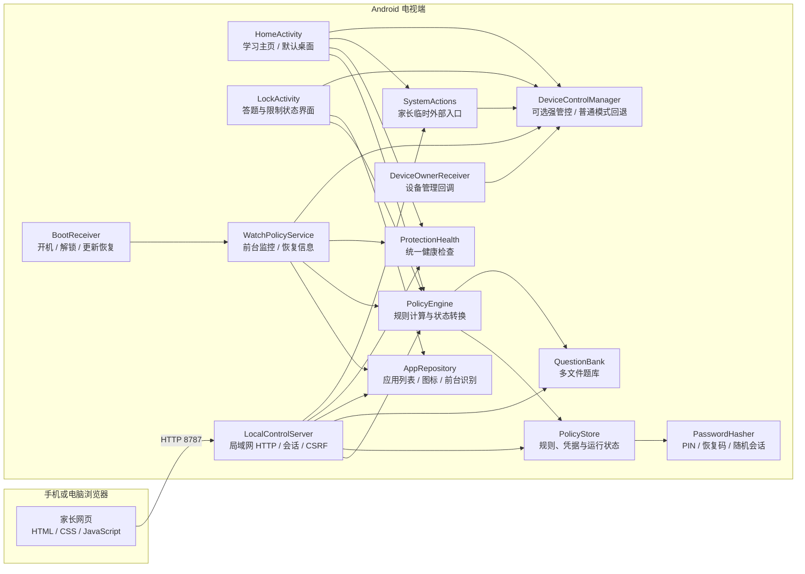

# 电视学习系统架构

本文描述当前第一版的实际实现。项目状态、真机验证记录及尚未验收的能力以 `AGENTS.md` 为准。

## 1. 定位与边界

系统在可安装 Android 应用的电视、投影仪或电视盒子上运行，对家长选定的视频应用进行前台观看计时，在达到规则要求后展示答题或等待界面。答对后恢复观看，答错后等待一段时间再换题。

当前版本：

- 使用本地存储和同一局域网内的家长网页，不依赖云端。
- 通过全屏界面覆盖第三方视频应用，不直接控制其内部播放器。
- 普通模式不承诺阻止所有系统入口，也不承诺防卸载、防清除数据、防恢复出厂；Device Owner 管控需单独授权并按机型验收。
- 不限制孩子使用另一台设备查答案。
- 首台验证设备为 Android 9、API 28、ARMv7 的爱普生 CH-TW5700TX 内置智能系统。

## 2. 技术栈

- 原生 Android、Java 8 语言级别。
- `minSdk 28`，`targetSdk/compileSdk 35`。
- Gradle 8.9、Android Gradle Plugin 8.7.3、JDK 17。
- NanoHTTPD 2.3.1 提供局域网 HTTP 服务。
- 家长网页使用原生 HTML、CSS、JavaScript，无前端框架。
- 电视界面使用原生 Android View，由 Java 代码构建，无 AndroidX 依赖。

## 3. 总体结构



## 4. 核心模块

| 模块 | 当前职责 |
| --- | --- |
| `HomeActivity.java` | 学习主页、受管应用入口、健康异常提示、家长验证、恢复码展示 |
| `LockActivity.java` | 答题、答案反馈、家长本地解锁，以及冷却、休息、晚间禁用、每日上限界面 |
| `WatchPolicyService.java` | 前台服务、每秒监控、锁定界面恢复、桌面收回、屏幕开关、网页托管、启动来源与有界恢复 |
| `ProtectionHealth.java` | 汇总服务、权限、实际事件、默认桌面、受管应用与 Device Owner 状态，生成电视提示和网页 JSON |
| `SystemActions.java` | 电视/网页共用的原桌面解析、临时外部授权和启动失败回滚 |
| `DeviceControlManager.java` | Device Owner 检测、锁任务、默认桌面、防卸载、可回退用户限制、家长临时外部入口；失败时保留普通管控 |
| `PolicyEngine.java` | 观看计时、状态转换、答题判断、家长控制、规则修改后的当前周期折算 |
| `PolicyStore.java` | SharedPreferences 持久化、时间规则、应用开关、PIN/恢复码、初始化、日志 |
| `QuestionBank.java` | 题库解析、校验、多文件合并抽题、旧版迁移、原子写入、损坏隔离与恢复 |
| `AppRepository.java` | 查询可启动应用、加载并缓存官方图标、UsageStats 前台事件及诊断、默认桌面和实际受管应用检测 |
| `LocalControlServer.java` | 家长网页与 API、认证会话、CSRF 校验、安全响应头、请求大小限制 |
| `PasswordHasher.java` | 随机盐、PBKDF2 哈希、配对码、恢复码、会话和 CSRF 随机令牌 |
| `Ui.java` | 浅色/深色主题及本地持久化、设备密度适配、按钮、输入框、焦点边框和公共界面样式 |
| `BootReceiver.java` | 正常/快速开机、用户解锁和本应用覆盖升级后的服务恢复 |
| `DeviceOwnerReceiver.java` | 设备管理启用、锁任务进入/退出回调及服务恢复；爱普生真机尚未启用 Device Owner |

## 5. 页面与交互范围

### 5.1 电视端

电视端只有两个 Activity，但并非只有两种显示内容：

1. `HomeActivity`
   - 普通观看状态下的学习主页。
   - 应用启动入口和设备状态。
   - 家长身份验证弹窗。
   - 恢复码展示与确认。
   - 原桌面、默认桌面、观看统计权限的家长入口。
2. `LockActivity`
   - 待答题解锁。
   - 答错后的冷却与换题。
   - 强制休息。
   - 晚间禁用。
   - 每日观看上限。
   - 家长 PIN/恢复码输入及本地解锁。

### 5.2 家长网页

家长网页由电视端静态资源提供，包含状态、时间规则、应用、控制、安全、题库、日志等标签页。它不是电视 Activity，也不依赖独立安装的 iOS 或 Android 家长 App。

### 5.3 界面适配与受控导航

- 主页使用应用官方图标和名称，通过 `Ui.roundedIcon()` 统一圆角；图标按屏幕密度设置边界，不依赖固定的效果图分辨率。
- 应用卡片根据可用宽度及数量自动选择 1～3 列，宽度通常限制在 240～380dp，窄屏不足时以可用宽度为准。单个应用不会横向铺满，4 个采用 2×2，6 个为 3×2，7～8 个为 3 列多行。末行保持等宽左对齐，内容过高时滚动；应用增减提示位于栏目标题右侧，不再占用独立卡片。
- 主页以观看时间和应用卡片为主内容，设备设置、原桌面入口及主题切换使用底部小按钮；配对和恢复码只在需要时出现。窄屏操作区自动拆行，页面滚动不裁掉顶部品牌栏。
- 浅色/深色选择存储在独立的 `tv_learning_ui` SharedPreferences 中，默认浅色，切换入口只保留在主页。两个 Activity、各限制状态和家长验证弹窗共用主题；Activity 返回前台时核对主题是否变化，必要时重建，避免后台页面保留旧配色。
- 答题选项根据可用宽度采用单列或双列，家长 PIN 与本地解锁收为一行；长题干和多选项使用滚动显示，按键提示固定在底部。提交期间保护当前焦点并防止重复提交，不改变答题状态机。
- 冷却和强制休息使用圆环倒计时与解析/提示卡片。非答题限制页优先聚焦家长解锁按钮，点击后弹出 PIN/恢复码验证，不自动进入常显输入框。
- 锁定页按 Home 后可停留在学习主页，但 `locked`/`cooldown` 等状态、当前题和倒计时保持不变；主页应用卡片不会启动视频，返回键恢复原限制界面。其他应用或未经授权入口仍由服务收回。
- Home 的系统默认行为依赖将本系统设置为默认桌面，不能据此宣称未设默认桌面的设备也支持同样导航。

## 6. 观看计时与状态机

### 6.1 前台识别

`AppRepository` 使用 `UsageStatsManager` 读取应用前台/后台事件。`WatchPolicyService` 每秒取得前台包名，并交给 `PolicyEngine` 计算。

只有同时满足以下条件才扣减观看时间：

- 设备已完成家长初始化。
- 保护功能已开启。
- 屏幕处于开启状态。
- 当前前台应用属于家长勾选的应用集合。
- 当前周期允许观看。

学习主页、原桌面及未被勾选的应用默认不计时。系统记录息屏和开机状态，避免把息屏时间当成观看时间。

### 6.2 状态

| 状态 | 含义 |
| --- | --- |
| `idle` | 未初始化、保护暂停或服务尚未进入正常观看状态 |
| `watching` | 可以观看；仅在受管应用前台时扣减额度 |
| `locked` | 等待答对题目 |
| `cooldown` | 答错后的换题等待 |
| `break` | 强制休息 |
| `quiet` | 晚间禁用时段 |
| `daily_limit` | 已达到每日观看上限 |

观看额度另分为 `initial`、`reward`、`parent`，分别表示初始周期、答题奖励和家长单独增加的时长。修改普通规则时，当前周期按已用或已等待时间折算；家长单独增加的时长不按普通规则重算。

### 6.3 答题流程

1. 观看额度耗尽后进入 `locked`，持久化当前题目。
2. 答错后清除当前题、保存解析来源，并进入 `cooldown`。
3. 冷却时间结束后选择另一道题；仍需答对才能恢复观看。
4. 答对后写入奖励额度和 `reward` 周期，并尝试返回此前的视频应用。
5. 家长可通过网页直接解锁、免答或跳题，也可在电视端使用 PIN/恢复码解锁。

## 7. 数据存储

### 7.1 规则与运行状态

使用应用私有的 SharedPreferences：`tv_learning_store_v1`。

主要保存：

- 时间规则、受管应用集合、初始化状态。
- 当前状态、剩余观看/冷却时间、每日已用时间。
- 当前题与上一题的命名空间题号、最近视频应用。
- 家长 PIN 和恢复码的盐与哈希、网页不可见的一次性待展示恢复码。
- 开机计数、墙钟与单调时钟锚点、操作日志。

敏感凭据不应写入架构文档、日志或普通题库备份。

### 7.2 多文件题库

存储目录：`files/question_banks/`。

- `metadata.json`：文件 ID、名称、版本、启用状态、题目数和错误信息。
- `<bankId>.json`：每份题库的原始内容。
- 临时 `.tmp` 和 `.bak` 文件用于原子替换及异常恢复。
- 旧版 `active_questions.json` 在首次升级时迁移，不会覆盖其他文件。

当前限制：

- 单文件最多 500 题、4 MB。
- 最多 50 个文件。
- 所有文件合计最多 5000 题。
- 只有已启用、无错误且有有效题目的文件参与抽题。
- 题号使用 `bankId/questionId` 隔离，不同文件可含相同的原始题号。
- 同名上传更新原文件并保留启用状态，不清空其他文件。
- 删除全部文件后不会自动复活示例；只有从未初始化时才加入内置示例。

## 8. 局域网家长服务

`WatchPolicyService` 启动 `LocalControlServer`，默认监听 `8787` 端口。家长通过电视主页显示的局域网地址访问。

主要接口：

| 接口 | 用途 |
| --- | --- |
| `/api/bootstrap`、`/api/setup`、`/api/login`、`/api/logout` | 初始化、登录和退出 |
| `/api/state` | 当前状态、规则、应用、题库摘要、健康检查和日志 |
| `/api/policy` | 保存时间规则并折算当前周期 |
| `/api/control` | 解锁、免答、跳题、暂停/恢复保护、应用启停、临时打开原桌面 |
| `/api/questions` | 多文件列表和汇总 |
| `/api/questions/bank` | 查看单份题库 |
| `/api/questions/import` | 新增或同名更新题库 |
| `/api/questions/enable`、`/api/questions/delete` | 启停和删除指定文件 |
| `/api/security/change-pin` | 修改 PIN、轮换恢复码并清除全部会话 |

安全机制：

- 初始化使用有时效的配对码，并要求家长立即完成设置。
- PIN 和恢复码使用独立随机盐及 PBKDF2-HmacSHA256，当前为 50000 次迭代、256 位输出。
- 恢复码只在家长验证后展示，确认保存后删除待展示明文。
- 网页会话只保存在设备内存中，使用 HttpOnly、SameSite=Strict Cookie，采用滑动 30 分钟有效期。
- 写操作需要会话及 `X-CSRF-Token`。
- 手机“打开原系统桌面”复用上述认证，不接收任意包名，不增加观看时间；返回学习主页后撤销临时授权，家长无需在电视旁输入 PIN。
- 登录失败和电视端验证失败均有次数限制与临时阻断。
- 返回 CSP、`X-Frame-Options: DENY`、`nosniff`、禁止缓存等响应头。
- 当前为家庭局域网 HTTP，不是公网 HTTPS 服务，不应开放到公网或不可信网络。

## 9. 启动、升级与设备适配

- 首次安装或打开主页时启动前台服务和网页。
- `BootReceiver` 接收正常/快速开机、用户解锁和本应用覆盖升级；开机/升级触发最多三次、间隔 0/5/20 秒的有界恢复检查，服务已运行则停止。`START_STICKY` 处理系统允许的服务重建，不承诺强制停止、厂商禁止自启动后也能恢复。
- 新版覆盖升级已在 Android 9 模拟器和爱普生真机验证无需手动打开主页；其他 ROM 仍需单独验收。持久化状态决定恢复观看、答题或等待界面，重启检测和恢复写入日志。真机已验证正常重启后恢复同一待答题，真实拔电与厂商休眠另行记录。
- `ProtectionHealth` 区分权限授权与真实前台事件，检查服务/网页心跳、默认桌面和实际可启动的受管应用；网页展示启动来源、运行时间和具体问题，电视在异常时提示。诊断结果不等于未来重启一定成功。
- 默认桌面、使用统计权限和语音入口因厂商固件而异，应逐台检测。
- 未启用 Device Owner 时，保留原有前台监控、答题和家长控制。Device Owner 只能通过 ADB 或官方配置流程授权，应用不能自行提权。
- 已启用且保护开启时，`DeviceControlManager` 配置锁任务白名单、Home 键、持久化默认桌面、本应用防卸载及可回退用户限制。逐项策略失败会记录日志，并继续使用普通管控。
- 普通限时解锁只退出锁任务；家长明确暂停保护才撤销本模块的用户限制和卸载阻止。家长验证后的原桌面/设置使用临时授权，返回学习主页后恢复管控。
- Android 9 不支持 `DISALLOW_CONFIG_DEFAULT_APPS`，不将其列为该版本的已生效能力；默认桌面通过持久化首选 Activity 设置。
- 当前不默认挂起、禁用或隐藏视频和系统应用，不接入 Shizuku，不自动停用 ADB。恢复出厂限制不等于防止 Recovery 或刷机。
- 项目 `minSdk 28` 只表示 Android 9 及以上的代码支持范围，不代表所有设备已兼容。Device Owner 强管控须按 ROM、账户/用户条件和实测结果分级。
- 当前爱普生真机未声明 `android.software.device_admin`，Device Owner 激活实测被拒绝，继续使用基础管控；为管控需要停用了第三方 Aerial 桌面，但未 Root、未卸载，保留了恢复方式。这不代表其他设备也需要相同处理。

## 10. 构建与验证

在 Git Bash 中使用项目内工具链：

```bash
TOOLS="$PWD/.tools"
export JAVA_HOME="$(cygpath -w "$TOOLS/jdk17")"
export ANDROID_HOME="$(cygpath -w "$TOOLS/android-sdk")"
export ANDROID_SDK_ROOT="$ANDROID_HOME"
export GRADLE_USER_HOME="$TOOLS/gradle-home"
./gradlew.bat clean lintDebug assembleDebug --console=plain
```

标准输出 APK：`app/build/outputs/apk/debug/app-debug.apk`。

项目当前没有自动化测试脚手架。验证采用模拟器回归、真实浏览器、真实视频应用及真机操作；各项实测结果和未验证限制记录在 `AGENTS.md`。
